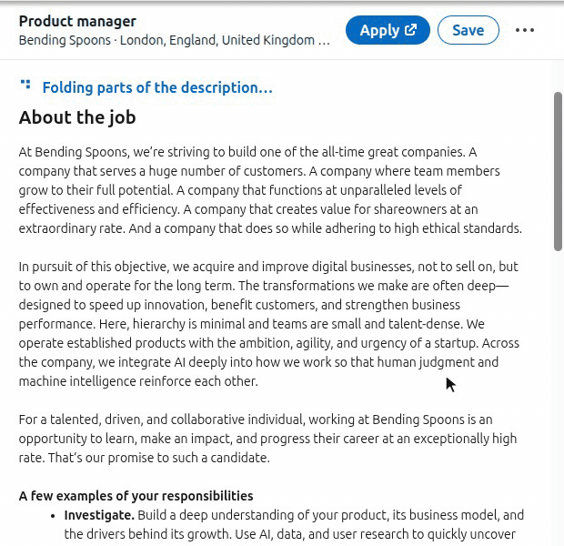
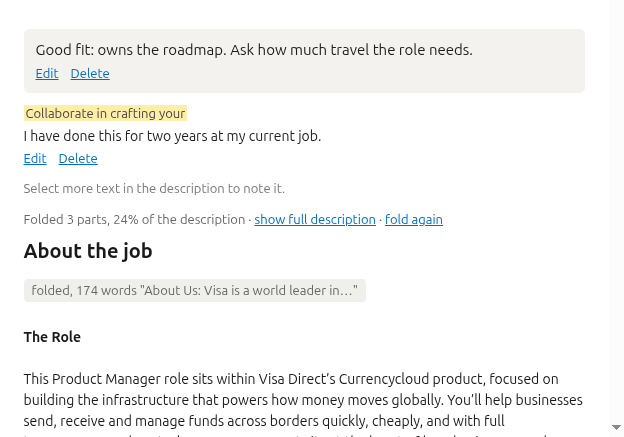
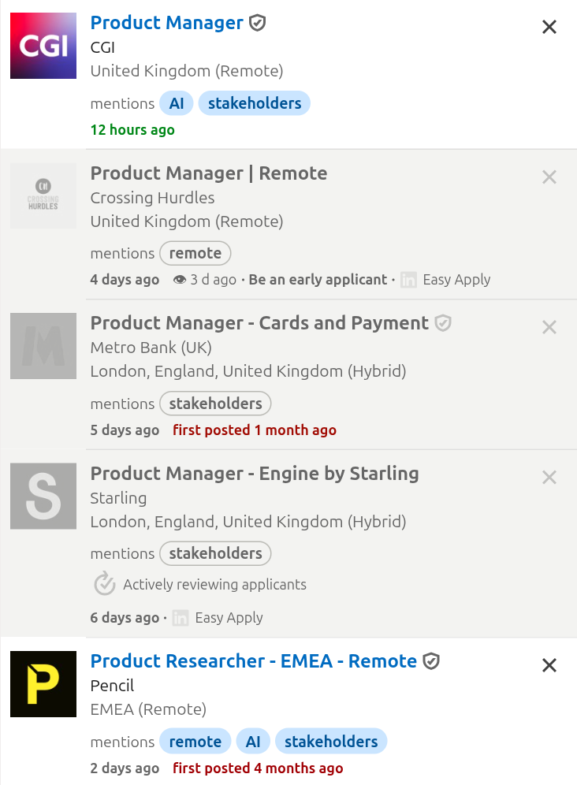
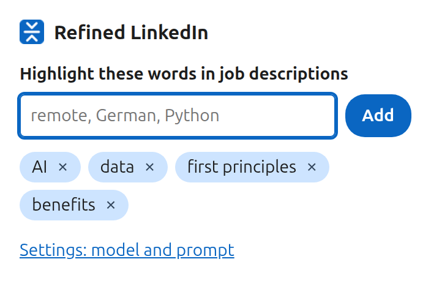
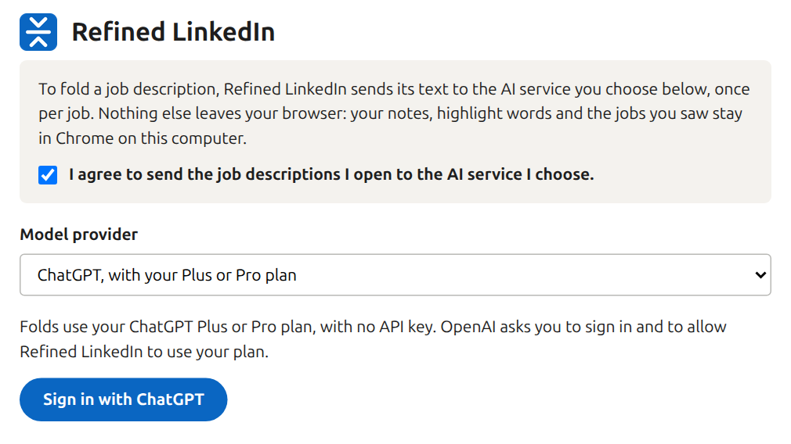

# Refined LinkedIn 🪗

**LinkedIn job descriptions, folded down to the job.**

A LinkedIn job post buries the job under the company pitch, the perks and the legal text. Refined LinkedIn is a
Chrome extension that folds those parts away, so you see what you would do and what they expect from you. It also
remembers which jobs you already opened. It is free and open source.

## What you get

- **Only the job.** Each hidden part becomes one grey line that says how many words it hides and how they start.
  Click the line to read the part. A line at the top sums it up: "Folded 3 parts, 65% of the description". Lines
  about years of experience, degrees or language levels stay visible even inside a fold.
- **Your words, highlighted.** Keep a list such as "remote", "German" or "SQL", and they show in blue in every
  description, along with their usual forms: "agent" also finds "agents" and "agentic". If one is inside a folded
  part, its grey line says so: "· mentions remote". Each card in a job list shows the ones its description mentions,
  so you see them before you open the job.
- **Notes that stay with the job.** Write a note on a job, or select a sentence in the description and attach a
  note to it. Your notes sit at the top of the job's description, and the job list shows a note icon you can
  hover without opening the job.
- **Seen jobs stay seen.** Jobs you opened turn grey in every list, with the time you saw them: "👁 3 days ago".
  If a company reposts the job under a new link, it still shows as seen.
- **Grey out the jobs you don't want.** Under **Grey out** in the pop-up, tick what you'd rather not see: jobs
  that aren't remote (LinkedIn's Remote filter still lists hybrid ones), reposted jobs, jobs with over 100
  applicants, promoted jobs and jobs you applied to. Add companies, or words such as "Intern" or "Senior" that a
  job's title must not have. Those jobs turn grey like a seen one, and say why where the card doesn't: "over 200
  applicants". Under an open job, **Grey out jobs from** its company adds it in one click. Tick **Hide them
  instead of greying them** and they leave the list, along with jobs you dismissed with LinkedIn's ×.
- **Dismiss the grey jobs in one click.** Above a job list, **Dismiss the 7 grey jobs** clicks LinkedIn's own ×
  on every grey card, so LinkedIn stops recommending them. The open job and saved jobs are left alone.
- **Fresh or stale at a glance.** Each job's age runs from green (a day old) through yellow and orange to red
  (two months).
- **Old jobs posted again say so.** LinkedIn shows a reposted job as new. Its card now also says when it was first
  posted, "first posted 4 months ago", in the colour of that date, and LinkedIn's newer age turns plain grey.
- **Your jobs, kept.** Every job you open or scroll past in a list is kept on your computer, with its description,
  title, employer and place. **Download my jobs** in the settings saves them all as one file, with when you opened
  each job, the words it mentions and your notes, for an AI chat or your own scripts.
- **You choose the AI that folds.** Use your ChatGPT Plus or Pro plan, a Google Gemini account, or another AI
  service. You can read and change the instructions the AI follows, and try them out in the settings.

**Notes at the top of a job's description**

**A job list: your words on each card, seen and hybrid jobs in grey, ages in colour, and reposts' first dates**

**Your words and the remote switch, in the pop-up behind the toolbar icon**

## Install

1. Open [Refined LinkedIn in the Chrome Web Store](https://chromewebstore.google.com/detail/refined-linkedin/gindiffhjdbhhgjdlcgeoakfcjcclabh) and click **Add to Chrome**.
2. Pin the extension: click the puzzle piece next to the address bar, then the pin next to Refined LinkedIn.
3. The settings open by themselves. Tick **I agree to send the job descriptions I open to the AI service I
   choose**, then choose the AI that folds the descriptions:
   - **ChatGPT, with your Plus or Pro plan**: click **Sign in with ChatGPT**, then sign in on the OpenAI page that
     opens and allow Refined LinkedIn to use your plan. Then pick a model from the list. No key needed.
   - **Google Gemini**: paste a key from [Google AI Studio](https://aistudio.google.com/apikey).
   - **Other OpenAI-compatible API**: its address, key and model.

   Then click **Save and test**.

   
4. Open any job on LinkedIn. After a few seconds the description shows a grey line where each part was folded,
   like the animation above.

Chrome updates the extension by itself.

### Install from a folder instead

A new version reaches the store after Google reviews it. To get it the day it comes out, load it from a folder.
A copy loaded from a folder keeps its own notes and history, apart from the store copy's.

1. Download the `.zip` file from the [latest release](https://github.com/testy-cool/refined-linkedin/releases/latest).
   Its name starts with `refined-linkedin-`.
2. Unzip it somewhere you will keep it, such as your `Documents` folder. Chrome runs the extension from that
   folder, so do not delete it.
3. In Chrome's address bar, type `chrome://extensions` and press Enter.
4. Turn on **Developer mode**, the switch at the top right. It lets Chrome load an extension from a folder.
5. Click **Load unpacked** and pick the folder you unzipped, the one that contains `manifest.json`.
6. Follow steps 2 to 4 above.

**Updating from a folder:** download and unzip the new version, then click **Load unpacked** again and pick the
new folder. Chrome replaces the old version and keeps your notes, words and history. You can then delete the old folder.

## What leaves your browser

- Nothing is sent until you tick the box at the top of the settings. Untick it to stop.
- The text of a job description you open goes to the AI you chose, once. The extension keeps the answer, so it
  sends that job again only if you click **fold again**.
- To show when each job in a list was first posted, whether it is remote, and which of your words its description
  mentions, the extension asks LinkedIn for that job's data, as LinkedIn's own pages do when you open a job. With
  "Jobs with over 100 applicants" ticked, it also asks LinkedIn's public page for the job how many people applied.
  These requests go to LinkedIn only.
- Nothing else is sent anywhere. Your notes, your words, the jobs you saw with their descriptions, and your settings
  stay in Chrome on your computer. There is no Refined LinkedIn server.
- Without an AI chosen, everything except folding still works.
- The full [privacy policy](PRIVACY.md) lists everything the extension keeps and sends.

## Good to know

- It works in Chrome on a computer. Other browsers built on Chromium may work, but have not been tried.
- LinkedIn changes its pages often. If something stops working, please
  [open an issue](https://github.com/testy-cool/refined-linkedin/issues).
- Each fold uses some of your ChatGPT plan's usage, if you fold with ChatGPT.

## More

- [What's new](CHANGELOG.md), version by version.
- [How it works, and how to build it](docs/DEVELOPMENT.md).
- Free and open source, under the [MIT licence](LICENSE).
